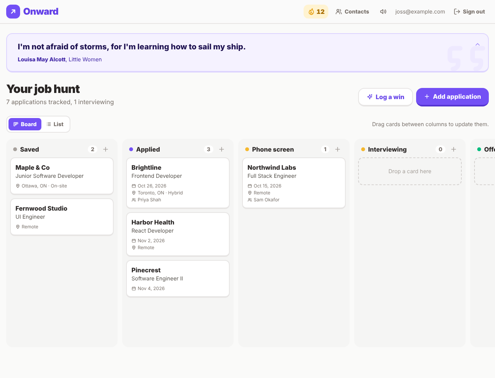

# Onward

A job hunt tracker that makes the search feel rewarding. Track your applications on a drag-and-drop board, get a little celebration every time you move forward, keep a daily streak, and watch your effort fill in a GitHub-style heat map, whether or not it pays off right away.



**Guiding principle: reward effort, not outcomes.** Applying, networking, and prepping are wins on their own.

## What's here so far

Onward is being built in milestones. So far:

**Milestone 1**
- Accounts: sign up, sign in, sign out
- Job applications with dates, links, salary, location, work arrangement, job description, resume version, and notes
- Contacts, linked to the applications they're connected to
- Light and dark mode, and a layout that works on phones

**The board and encouragement**
- A drag-and-drop board, the main view on computers. Phones get a list view by default, and on the board you press and hold a card to drag it.
- Customizable columns: add, rename, reorder, and delete them. Each column has a type (saved, applied, interviewing, offer, rejected), so "Phone screen" and "Final round" both count as interviewing.
- A daily quote at the top of the board. Every quote's wording was checked against its original source.
- Celebrations that scale: confetti and a chime for applying, more for an interview, a full-screen celebration for an offer, and a kind word when you get a rejection.
- A sound toggle in the header. Confetti is skipped when your device is set to reduce motion.
- Add a contact right from an application's form.

**Milestone 2: streak and progress**
- A daily streak, shown as a flame in the header. Any activity counts, and the day follows your own time zone.
- Streak freezes: earn one for every 7 days in a row, hold up to 2, and a missed day uses one automatically.
- A Progress page with "Log a win" buttons for networking messages, coffee chats, follow-ups, and tailored resumes or cover letters.
- Applying, interviews, offers, and rejections on the board are logged for you, once per application for each stage type.
- A GitHub-style heat map of your activity: a year on computers, about four months on phones.
- A weekly recap you can copy as text or share as an image, with company names left out unless you include them.
- Celebrations at streak milestones like 7, 30, and 100 days.

Coming next: daily quests, interview prep, a study timer, custom actions, and nudges (milestone 3), then visual polish and deployment (milestone 4).

## Tech stack

| Part | Tools |
| --- | --- |
| Backend | Ruby on Rails 8 (API only), PostgreSQL |
| API | GraphQL via [graphql-ruby](https://graphql-ruby.org) |
| Frontend | React 19, TypeScript, Vite, Tailwind CSS 4 |
| Data fetching | Apollo Client, with types generated by GraphQL Code Generator |

The app is two parts that run side by side: the Rails API in `backend/` and the React app in `frontend/`. In development, Vite forwards API requests to Rails, so you only ever open one address in your browser.

## Setting up

You'll need:

- **Ruby 3.2 or newer** (3.3 recommended)
- **Node.js 20 or newer**
- **PostgreSQL 14 or newer**

Pick the steps for your computer, then continue with [Running Onward](#running-onward).

### macOS

1. Install [Homebrew](https://brew.sh) if you don't have it.
2. Install the tools:

   ```sh
   brew install rbenv ruby-build node postgresql@16
   brew services start postgresql@16
   ```

3. Make PostgreSQL's command-line tools available (the Ruby `pg` gem needs them to install). Add this line to your `~/.zshrc`, then open a new terminal:

   ```sh
   export PATH="$(brew --prefix postgresql@16)/bin:$PATH"
   ```

4. Install Ruby and make it your default:

   ```sh
   rbenv init      # follow the instructions it prints, then open a new terminal
   rbenv install 3.3.6
   rbenv global 3.3.6
   ```

On macOS, PostgreSQL lets your user connect without a password, so there's nothing else to configure.

### Linux (Ubuntu or Debian)

1. Install build tools, PostgreSQL, and the libraries Ruby needs:

   ```sh
   sudo apt update
   sudo apt install -y build-essential git curl libssl-dev libyaml-dev zlib1g-dev libffi-dev libpq-dev postgresql
   ```

2. Start PostgreSQL and create a database user that matches your login, so Rails can connect without a password:

   ```sh
   sudo service postgresql start
   sudo -u postgres createuser --superuser "$USER"
   ```

3. Install Ruby with [rbenv](https://github.com/rbenv/rbenv#installation):

   ```sh
   curl -fsSL https://github.com/rbenv/rbenv-installer/raw/HEAD/bin/rbenv-installer | bash
   # follow the instructions it prints, then open a new terminal
   rbenv install 3.3.6
   rbenv global 3.3.6
   ```

4. Install Node.js with [nvm](https://github.com/nvm-sh/nvm#installing-and-updating):

   ```sh
   curl -o- https://raw.githubusercontent.com/nvm-sh/nvm/v0.40.3/install.sh | bash
   # open a new terminal
   nvm install --lts
   ```

### Windows

Rails runs best on Windows through **WSL** (Windows Subsystem for Linux), which gives you a real Linux environment.

1. Open PowerShell as administrator and run:

   ```powershell
   wsl --install
   ```

2. Restart when asked, then open **Ubuntu** from the Start menu and create a Linux username and password.
3. Inside Ubuntu, follow the [Linux steps](#linux-ubuntu-or-debian) above.
4. Keep the project inside your Linux home folder (for example `~/code/onward`), not under `/mnt/c/`. It runs much faster there.

PostgreSQL in WSL doesn't start on its own. When you open a new Ubuntu window, run `sudo service postgresql start` before starting Onward.

### If PostgreSQL needs a password

If your PostgreSQL setup uses a username and password, copy the example settings file and fill them in:

```sh
cd backend
cp .env.example .env
# then edit .env and set DATABASE_USERNAME and DATABASE_PASSWORD
```

## Running Onward

### 1. Set up and start the API

```sh
cd backend
bin/setup          # installs gems, creates the database, writes the GraphQL schema
bin/rails server   # starts the API on http://localhost:3000
```

Want sample data to click around with? In another terminal, run `bin/rails db:seed` from `backend/`. It creates a demo account you can sign in with: **demo@onward.test** / **password123**.

### 2. Start the frontend

In a second terminal:

```sh
cd frontend
npm install
npm run dev
```

Open **http://localhost:5173** and create an account.

Keep both terminals running while you use the app.

## Updating to a new version

When you get a new version of the code, update the database and the GraphQL schema before starting the app:

```sh
cd backend
bin/setup          # installs any new gems, runs new migrations, rewrites the schema
bin/rails server
```

Then, in a second terminal, start the frontend as usual with `npm run dev` in `frontend/`.

Migrations update your existing data. For example, the board's migration gives everyone the default columns and puts each existing application in the column that matches its status.

## Running the tests

```sh
cd backend
bin/rails test
```

## Changing the API

The frontend's TypeScript types come from the backend's GraphQL schema. After you change anything in `backend/app/graphql/`:

```sh
cd backend
bin/rails graphql:dump_schema   # updates backend/schema.graphql

cd ../frontend
npm run codegen                 # regenerates the types in src/gql/
```

`npm run dev` and `npm run build` run codegen for you, and a backend test fails if `schema.graphql` is out of date, so it's hard to forget.

All the queries and mutations the frontend sends live in `frontend/src/graphql/operations.ts`.

## Project layout

```
backend/
  app/graphql/        GraphQL schema: types, queries, and mutations
  app/models/         Users, board columns (stages), applications, contacts, activities, streaks
  db/migrate/         Database tables
  test/               Model and API tests
  schema.graphql      Generated schema the frontend reads
frontend/
  src/pages/          One file per screen
  src/components/     Shared building blocks (buttons, layout, icons)
  src/graphql/        Every query and mutation the app uses
  src/lib/            Helpers: quotes, celebrations, sounds, confetti, settings
```

## Troubleshooting

**`bin/setup` says permission denied.** Some unzip tools drop the "executable" flag. Run `chmod +x backend/bin/*` and try again.

**Installing the `pg` gem fails.** Ruby can't find PostgreSQL's tools. On macOS, check step 3 of the macOS setup. On Linux, make sure `libpq-dev` is installed.

**"Connection refused" or "could not connect to server."** PostgreSQL isn't running. Start it with `brew services start postgresql@16` (macOS) or `sudo service postgresql start` (Linux and WSL).

**"role does not exist."** Create a PostgreSQL user for yourself: `sudo -u postgres createuser --superuser "$USER"`.

**The app says it couldn't reach the Onward server.** The Rails API isn't running. Start it with `bin/rails server` in `backend/`.

**The frontend says a field doesn't exist, or `npm run dev` fails at "codegen."** The GraphQL schema file is out of date. Run `bin/rails graphql:dump_schema` in `backend/`, then try again.

**There's no sound.** Check the speaker button in the header, and that your device isn't muted. Browsers only play sound after you've clicked or tapped something on the page.

## License

[MIT](LICENSE) © 2026 JossWritesCode
