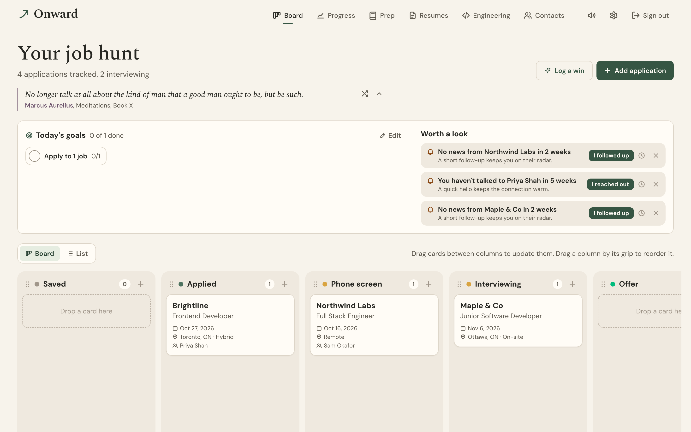

# Onward

[](https://github.com/JossWritesCode/onward/actions/workflows/ci.yml)

A job hunt tracker that feels like a well-kept notebook. Its guiding idea: **reward effort, not outcomes.** Applying, networking, and prepping are wins on their own, whether or not they pay off right away.

**Try it live at [onward-wzja.onrender.com](https://onward-wzja.onrender.com/).**



## What it does

- **A drag-and-drop board** for your applications, with columns you can rename and reorder. Phones get a list view. Drop a card in the wrong column by mistake? Move it back within a day and Onward forgets it happened.
- **Follow-up dates** that Onward picks for you, with reminders when it's time to follow up, send a thank-you, or let an application go.
- **Streaks, daily goals, and a heat map** that count what you did, not what you heard back. Missed a day? Streak freezes have you covered.
- **A weekly recap** you can copy or share as an image.
- **Interview prep:** a story bank, practice questions with a timer, a checklist for each round, and a study timer.
- **Resumes** with three templates and a live PDF preview. Tailor one for a job with the AI chat you already use, so there's nothing extra to pay for.
- **A "Save to Onward" bookmark** that fills in a job from LinkedIn, Indeed, or a company's careers page.
- **An optional software engineering track** with your LeetCode and GitHub activity.
- Light and dark themes, gentle sounds you can turn off, and a layout that works on phones.

[Using Onward](docs/using-onward.md) explains these in more detail.

## Running it on your computer

You'll need **Ruby 3.2+**, **Node.js 22.15+**, and **PostgreSQL 14+**. If you don't have them yet, follow [Installing the tools](#installing-the-tools) first.

```sh
cd backend
bin/setup           # installs gems, sets up the database
bin/rails db:seed   # optional: adds a demo account
bin/rails server    # the API, on port 3000
```

In a second terminal:

```sh
cd frontend
npm install
npm run dev
```

Open **http://localhost:5173**. Sign in as **demo@onward.test** / **password123**, or create your own account. Keep both terminals running while you use the app.

When you pull a new version, run `bin/setup` in `backend/` again. It installs anything new and updates your database.

### Installing the tools

**macOS**, with [Homebrew](https://brew.sh):

```sh
brew install rbenv ruby-build node postgresql@16
brew services start postgresql@16
echo 'export PATH="$(brew --prefix postgresql@16)/bin:$PATH"' >> ~/.zshrc
rbenv init          # follow what it prints, then open a new terminal
rbenv install       # run this from the Onward folder
```

**Linux (Ubuntu or Debian):**

```sh
sudo apt update
sudo apt install -y build-essential git curl libssl-dev libyaml-dev zlib1g-dev libffi-dev libpq-dev postgresql
sudo service postgresql start
sudo -u postgres createuser --superuser "$USER"
```

Then install Ruby with [rbenv](https://github.com/rbenv/rbenv#installation) (run `rbenv install` from the Onward folder) and Node.js with [nvm](https://github.com/nvm-sh/nvm#installing-and-updating) (`nvm install --lts`).

**Windows:** run `wsl --install` in PowerShell as administrator, restart, open **Ubuntu**, and follow the Linux steps. Keep the project in your Linux home folder, not under `/mnt/c/`. PostgreSQL doesn't start on its own in WSL, so run `sudo service postgresql start` in each new window.

**If your PostgreSQL needs a password,** copy `backend/.env.example` to `backend/.env` and fill in `DATABASE_USERNAME` and `DATABASE_PASSWORD`.

## More guides

- [Using Onward](docs/using-onward.md): follow-ups, resumes and tailoring, the bookmark, LeetCode and GitHub, and invites
- [Putting Onward online](docs/hosting.md): hosting on Render and sending email
- [Working on Onward](docs/development.md): tests, changing the API, and where things live
- [If something doesn't work](docs/troubleshooting.md)

## Built with

Ruby on Rails 8 and PostgreSQL for a GraphQL API, and React 19, TypeScript, Vite, and Tailwind CSS for the app.

## License

[MIT](LICENSE) © 2026 JossWritesCode
